# Alcance

## Objetivo

`mi-lsp` es una CLI semántica local para proyectos y repos heterogéneos, orientada a agentes y desarrolladores que necesitan navegar código con alta confiabilidad y bajo consumo de tokens. Ofrece semántica profunda C# con Roslyn, catálogos locales para TypeScript/JavaScript y Python, y catalogación AST nativa para Go con enriquecimiento opcional vía `gopls`. El CLI es la única superficie de navegación. La puerta MCP local `mi-lsp mcp` fue retirada el 2026-10-15; `mi-mcp` invoca el CLI por llamada.

El exito del producto en v1.3 se mide por estos resultados:
- la CLI siempre responde aunque el daemon no este activo;
- el servicio de navegación se consume por la CLI; las llamadas MCP llegan vía `mi-mcp`, que ejecuta el CLI por cada llamada, sin proceso MCP persistente;
- el primer uso puede resolverse con `mi-lsp init` sin onboarding largo;
- `nav wiki` ofrece una entrada documental explícita para agentes que buscan RF/FL/TP/CT/TECH/DB, y `nav wiki map` un catálogo compacto de hubs de wikis de conocimiento (`wiki/` y `bibliotecas/`);
- `nav ask` responde preguntas de intención usando wiki + evidencia de código;
- `nav pack` entrega el orden de lectura canónico para una tarea con preview/full;
- el grafo nativo publica una topología estable y compiler-first con `GraphGeneration` y `NodeKey` reproducibles; `index --docs-only` también puede publicar un grafo documental de markdown canónico en `wiki/` y `bibliotecas/`;
- las consultas de grafo permiten consultar, explicar e inspeccionar impacto sin convertir el índice en un editor;
- las extensiones `MILX-v1` se ejecutan aisladas y no pueden degradar la confiabilidad del core;
- las superficies calientes de navegacion pueden devolver guidance tiny (`continuation`) y memoria de reentrada (`memory_pointer`) para ayudar a un harness a seguir explorando sin gastar muchos tokens;
- `nav intent` agrega un modo hibrido `docs|code|mixed` (`mixed` cuando la pregunta trae señales de código: matches de código fuertes primero, luego docs): las consultas capability-like deben devolver docs canónicos owner-aware y las consultas symbol-like deben seguir devolviendo matches de catalogo/codigo;
- las consultas semánticas C# entregan contexto util y compacto en repos grandes;
- clientes MCP acceden a las mismas operaciones de navegación mediante `mi-mcp`, que invoca el CLI, con workspace visible y resultados estructurados (la puerta `mi-lsp mcp` está retirada);
- la salida es estable, breve y apta para skills/LLMs sin arrastrar blobs innecesarios.

## Propuesta de valor

- Ofrece una CLI directa con daemon opcional. La integración con clientes MCP pasa por `mi-mcp`, que invoca el CLI; la puerta local `mi-lsp mcp` está retirada.
- Mantiene una puerta de entrada corta para onboarding: `init -> nav ask`.
- Agrega un reading pack canónico (`nav pack`) para reducir round-trips al estudiar la wiki en orden spec-driven.
- Agrega `nav wiki` para hacer obvia la exploracion documental y guiar a pack/trace/multi-read/ask.
- Usa primero la documentacion canónica del repo cuando existe `.docs/wiki`, en vez de obligar al usuario a adivinar comandos o rutas.
- Conecta wiki y código sin convertir el índice local en una base semántica pesada.
- Opera bien en workspaces independientes y multiples repos abiertos al mismo tiempo.
- Cuando el usuario omite `--workspace`, prioriza el workspace registrado que contiene el `cwd` real del caller antes de caer al `last_workspace` global.
- `nav.search` debe tolerar patrones "regex-like" copiados tal cual y reintentar como literal cuando el regex es invalido.
- `nav.ask` debe resolver una primera respuesta util por camino directo, sin depender del daemon como hot path por default.
- `workspace list` y `nav workspace-map` deben arrancar en modo summary-first y reservar scans pesados para expansiones explicitas.
- Devuelve envelopes JSON compactos, deterministas y orientados a presupuesto de tokens.
- Resume la superficie observable de un servicio (`nav service`) sin colapsar en un score fuerte de completitud.
- Mantiene el estado operativo dentro del repo y solo usa un registro global mínimo para aliases.

## Capacidades

```mermaid
flowchart TD
    A[mi-lsp CLI] --> B[Workspace y aliases]
    A --> C[Navegacion semantica]
    A --> D[Indexacion local]
    A --> E[Daemon opcional]

    B --> B1[init corto para primer uso]

    C --> C1[C# profundo con Roslyn]
    C --> C2[TS/Next basico]
    C --> C3[Busqueda textual]
    C --> C4[Python basico con Pyright opcional]
    C --> C5[Service exploration evidence-first]
    C --> C6[nav ask docs-first]
    C --> C7[nav pack canonico]
    C --> C8[nav wiki documental]
    C --> C9[Federacion wiki cross-workspace]
    C --> C10[Go AST nativo + gopls opcional]
    C --> C11[Graph query: consultar, explicar, impactar]
    C --> C12[Extensiones MILX-v1 aisladas]

    D --> D1[Catalogo de simbolos]
    D --> D2[Metadatos de archivos]
    D --> D3[Grafo documental wiki-aware]
    D --> D4[Presupuesto de salida]
    D --> D5[Grafo nativo: nodos, aristas y generaciones]

    E --> E1[Worker pool por workspace]
    E --> E2[Fallback directo]
```

## Actores

- Desarrollador: ejecuta la CLI manualmente para explorar, entender y diagnosticar codigo.
- Skill/Agente LLM: consume `mi-lsp` como herramienta CLI con salida compacta y confiable.
- Maintainer de wiki: define la estructura canónica en `.docs/wiki` y, cuando hace falta, el `read-model` del proyecto.
- Worker .NET: resuelve semántica profunda C# y responde datos derivados.
- Daemon opcional: mantiene workers calientes por workspace y reduce latencia warm.
- Workspace local: fuente de verdad del índice repo-local, configuración y archivos de codigo.

## Áreas funcionales

- Gestion de workspaces: alta, inicializacion corta, descubrimiento, aliases, estado y warmup. `workspace which` resuelve el alias o root y el ejecutable en uso sin mutar el registry. Ver [[RF-WKS-009]]. `nav suggest` sugiere un comando `nav` que la CLI ya expone. Ver [[RF-QRY-020]]. La puerta MCP local que las exponía por stdio fue retirada; ver [[RF-QRY-021]] (retirado).
- Navegacion y discovery: símbolos, referencias, outline, overview, contexto, dependencias, exploracion `nav wiki`, preguntas docs-first, reading packs canónicos, busqueda por intención y resumen de servicios. En workspaces `container`, `find/search/intent` pueden acotar por `--repo` sin perder el modo directo. Federacion wiki: `nav wiki-root` resuelve raíces `&#91;&#91;canon&#93;&#93;` externas o el default `.docs/wiki`; `--all-workspaces` recorre wikis de multiples espacios en una sola máquina con fan-out controlado. Ver [[FL-WIKI-01]] y [[RF-WKS-008]].
- Indexación repo-local: catálogo liviano de símbolos, archivos, metadatos del workspace y grafo documental; el grafo nativo se genera y publica con [[FL-GPH-01]].
- El grafo nativo agrega consultas para consultar, explicar e impactar. Ver [[FL-GPH-02]].
- Extensibilidad aislada: ejecución de extensiones `MILX-v1` con límites de proceso, permisos y salida. Ver [[FL-GPH-03]].
- Enrutamiento semántico: Roslyn para semántica profunda C#; tree-sitter/ripgrep para TS/Next y texto; Pyright para Python cuando este disponible; extractor AST nativo para Go con enriquecimiento `gopls` opcional; fallback catalog/text visible cuando la semántica profunda no esta disponible.
- Formateo de salida: envelopes JSON compactos, truncación determinista y warnings explicitos.
- Operación runtime: daemon opcional, worker install explícito y fallback cuando faltan dependencias.
- Puerta MCP: retirada el 2026-10-15. `mi-lsp mcp` ya no existe; `mi-mcp` invoca el CLI por llamada. Histórico en [[TECH-MCP-ADAPTER]].

## Fuera de alcance

- Edicion y refactor semántico seguro.
- MCP remoto/HTTP o un servidor MCP persistente de terceros, dashboard web o GUI remota. `mi-mcp` es un producto externo que invoca el CLI; no es un servidor MCP de mi-lsp.
- Semántica TypeScript profunda equivalente a C# mediante `tsserver`.
- Soporte activo para lenguajes fuera de C#/TS/Python/Go en v1.
- Persistencia semántica completa de referencias y jerarquias C# en SQLite.
- Embeddings, reranking externo o servicios remotos para `nav ask`.
- Mutación del grafo desde extensiones; `MILX-v1` queda limitado a ejecución aislada y resultados declarativos en este corte.
