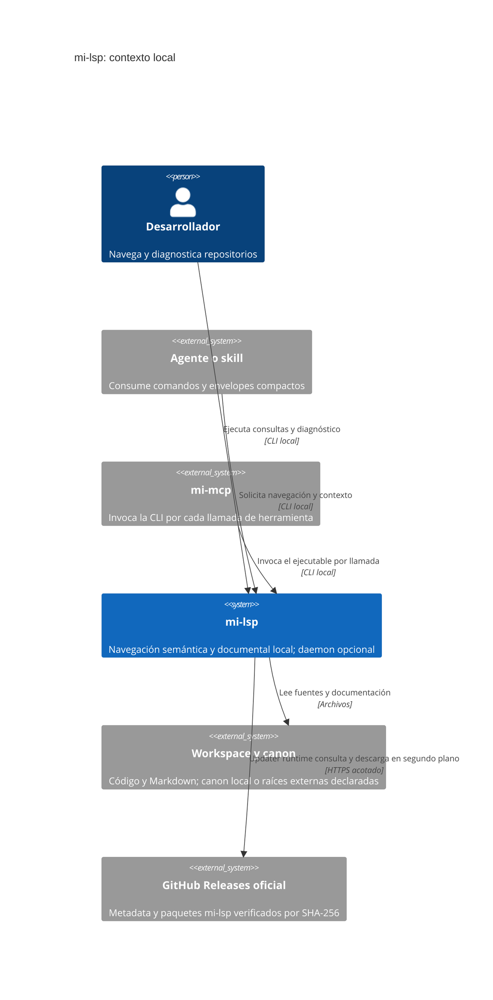
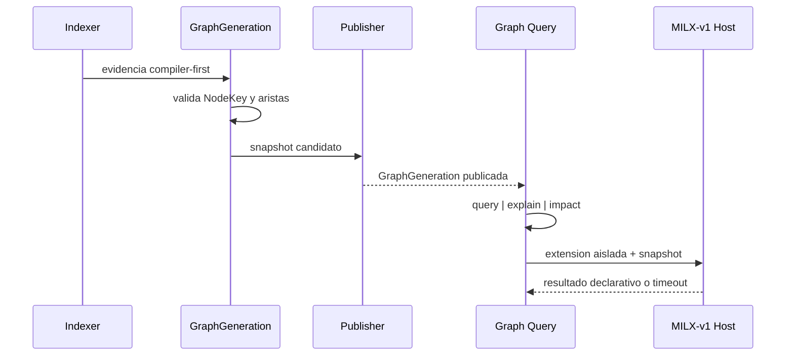

## Contexto

CLI semántica local con daemon opcional, backends especializados y almacenes derivados. La wiki es autoridad; catálogo y grafo no la sustituyen.

### C4 de contexto

El sistema es mi-lsp, consumido por desarrolladores y agentes a través de su CLI local. mi-mcp es un consumidor externo que invoca esa misma CLI por llamada; no representa una puerta MCP residente de mi-lsp. El workspace aporta código y documentación, incluido el canon externo cuando está declarado.



## Contenedores (C4)

El diagrama y las responsabilidades del detalle describen CLI/core Go, daemon/UI loopback, workers, SQLite y registry.

### C4 de contenedores

CLI y daemon son procesos distintos que reutilizan el core Go; el daemon no es requisito para la CLI. Docgraph, catálogo Go, generación de grafo y exploración de servicios son componentes del core, no servicios nuevos. La consola loopback pertenece al daemon. El grupo de backends opcionales representa procesos de lenguaje disponibles según el workspace, no un worker único ni una promoción del backend Kotlin experimental.

```mermaid
C4Container
    title mi-lsp: contenedores locales
    Person(developer, "Desarrollador", "CLI y consola operativa local")
    System_Ext(clients, "Agentes, skills y mi-mcp", "Consumidores de la CLI")
    System_Ext(sources, "Fuentes y canon del workspace", "Código y Markdown, con raíces declaradas")
    System_Ext(releases, "GitHub Releases oficial", "fgpaz/mi-lsp: latest, checksums y assets por RID")
    System_Boundary(milsp, "mi-lsp") {
        Container(cli, "CLI y core directo", "Go", "Comandos, routing, docgraph, catálogo, grafo y salida compacta")
        Container(daemon, "Daemon compartido y consola", "Go y UI loopback", "Core compartido, runtime pool, gobernanza y telemetría")
        Container(roslyn, "Worker Roslyn", ".NET / Roslyn", "Semántica profunda C# por entrypoint")
        Container(optional, "Backends de lenguaje opcionales", "tsserver, Pyright y gopls", "Enriquecimiento cuando el backend está disponible")
        Container(extension, "Host y extensión MILX-v1", "Procesos aislados", "Snapshot publicado, capabilities y salida declarativa")
        Container(winhost, "Host Windows candidato", "Go / PE GUI", "Productor execsafe-host/v1; job privado y streams sin framing")
        ContainerDb(index, "Índice repo-local", "SQLite", "Catálogo, documentos y generaciones de grafo derivados")
        ContainerDb(state, "Estado y telemetría del daemon", "JSON, SQLite y logs", "Estado global del usuario y log repo-local")
        ContainerDb(config, "Registro y configuración", "TOML", "Aliases globales y topología repo-local")
    }
    Rel(developer, cli, "Ejecuta comandos", "CLI local")
    Rel(clients, cli, "Invoca el ejecutable", "CLI local")
    Rel(clients, winhost, "Puede invocar tras admisión y verificación", "execsafe-host/v1; pendiente")
    Rel(winhost, cli, "Puede ejecutar CLI u otro payload absoluto como guest", "Handles stdio y job Windows")
    Rel(winhost, releases, "Se distribuye como dos assets candidatos", "SHA-256 y procedencia")
    Rel(developer, daemon, "Consulta la consola y acciones seguras", "HTTP loopback")
    Rel(cli, sources, "Lee fuentes y canon", "Archivos")
    Rel(cli, config, "Resuelve workspace y configuración; registra durante bootstrap", "Archivos")
    Rel(cli, index, "Consulta y publica derivados según la operación", "SQLite")
    Rel(cli, daemon, "Envía solicitudes daemon-aware; permite bypass o fallback", "Pipe / socket local")
    Rel(daemon, index, "Usa el core compartido para acceder al índice", "SQLite")
    Rel(daemon, state, "Mantiene estado, accesos y logs", "Archivos y SQLite")
    Rel(daemon, roslyn, "Reutiliza runtime por workspace y entrypoint", "stdio length-prefixed")
    Rel(cli, roslyn, "Ejecuta semántica en modo directo cuando corresponde", "stdio length-prefixed")
    Rel(daemon, optional, "Mantiene runtimes opcionales", "LSP")
    Rel(cli, extension, "Ejecuta la extensión sobre un snapshot publicado", "Protocolo MILX-v1")
    Rel(cli, releases, "Hijo updater verifica checksum y promueve sólo CLI", "HTTPS acotado")
```



El host Windows es un productor separado, no un reemplazo de CLI ni del host MILX; la relación consumidor y assets es candidata, todavía no publicada o admitida. El guest puede ser otra aplicación absoluta, no necesariamente la CLI. Ver [[TECH-WINDOWS-HOST]] y [[RF-HOST-001]]; UI y raíces del daemon no cambian. El C4 resume los límites ya descritos; no cambia los contratos de routing, seguridad, estado ni publicación. Si un diagrama difiere del texto, manda el texto.

### Vista del sistema

```mermaid
flowchart LR
    U[CLI mi-lsp] -->|daemon activo| D[Daemon global Go]
    U -->|sin daemon o bypass| C[Core Go directo]
    U --> I[Shortcut init]
    I --> C
    D --> C
    D --> UI[Governance UI loopback]
    C --> S[SQLite repo-local]
    C --> G[Registry global minimo]
    C --> X[Discovery TS/JS + ripgrep]
    C --> GO[Catalogo Go AST nativo]
    C --> DG[Docgraph + read-model]
    C --> GN[Graph-native pipeline]
    GN --> GS[GraphSnapshot + NodeKey]
    GN --> MX[MILX-v1 isolated host]
    C --> SV[Service exploration profile]
    D --> P[Runtime pool por workspace/backend/entrypoint]
    P --> R[Worker Roslyn]
    P --> T[tsserver opcional]
    P --> PY[Pyright opcional]
    P --> GP[gopls opcional]
    D --> DS[~/.mi-lsp/daemon state + db]
    D --> DL[{repoRoot}/.mi-lsp/daemon.log]
```

### Modelo canónico

- `Workspace single`: un repo con un root semántico obvio. Ejemplo: `gastos`.
- `Workspace container`: carpeta padre con muchos repos independientes. Ejemplo: `interbancarizacion_coelsa` sin depender de una `.sln` agregadora.
- El `registry.toml` global sigue siendo liviano: alias, root, languages y `kind`.
- La topología detallada vive en `<repo>/.mi-lsp/project.toml` con `repo[]`, `entrypoint[]`, `default_repo`, `default_entrypoint` y, cuando la wiki vive fuera del repo de código, `&#91;&#91;canon&#93;&#93;` `{id, root, role, mode}` resuelto desde la raíz del workspace (nunca desde `.mi-lsp/` ni cwd).
- El contexto de query incluye `caller_cwd`; si `--workspace` se omite, la resolución efectiva sigue `selector explicito > workspace registrado cuyo root contiene caller_cwd > last_workspace`.
- El índice repo-local persiste ownership por repo (`repo_id`, `repo`) para archivos y simbolos.
- El mismo índice repo-local persiste `DocRecord`, `DocEdge` y `DocMention` para `nav wiki`, `nav ask`, `nav pack`, `nav route` y `nav trace`.
- `workspace_meta` también puede persistir un snapshot repo-local de reentrada (`memory_snapshot_*`) construido en `index` a partir de la wiki canónica y del handoff reciente.
- El runtime pool del daemon se keyed por `(workspace_root, backend_type, entrypoint_id)`.
- `nav wiki search`, `nav ask`, `nav pack` y `nav route` comparten un contexto request-local de docs/profile/ranking para evitar recomputacion dentro de una misma request.
- El envelope de query puede agregar un bloque opcional `coach` query-level para guidance explícito cuando hay rerun/refinement claro.
- El mismo envelope puede agregar `continuation` y `memory_pointer` con costo bajo para orientar al harness en la siguiente busqueda o reentrada.
- El doc router comparte un scorer owner-aware para `nav wiki search`, `nav route`, `nav ask` y `nav pack`, y `nav.intent` clasifica primero `mode=docs|code` antes de elegir entre docs canónicos o BM25 de símbolos; con señales de código en una pregunta documental agrega código del catálogo en `mode=mixed`.
- `nav ask` rankea docs primero y usa el código como evidencia; `nav pack` usa la misma base para construir reading packs global -> especifico; `nav service` agrega evidencia scoped a un path usando catálogo y busqueda textual.
- El pipeline graph-native es compiler-first: produce `GraphGeneration` determinista, `NodeKey` estable y aristas explicables desde los backends disponibles; publicar es un paso versionado y reemplazable.
- Las extensiones `MILX-v1` solo leen el snapshot publicado y devuelven resultados declarativos desde un host aislado; no comparten memoria ni escriben el índice principal.

### Responsabilidades por módulo

- **Módulo**: CLI; **Responsabilidad**: Parseo de comandos, flags globales, selectors semánticos y shortcut `init`. Autoridad única de navegacion.
- **Módulo**: Self-update runtime; **Responsabilidad**: Un único motor para CLI/daemon y todos los consumidores, con caché/lock en home, estado por ejecutable, checksum y promoción/readback/rollback. No instala workers durante consultas; el reciclado del daemon requiere barrera idle real. Ver [[TECH-RUNTIME-UPDATE]] y [[FL-UPD-001]].
- **Módulo**: Puerta MCP; **Responsabilidad**: Retirada (2026-10-15). `mi-lsp mcp` ya no existe; `mi-mcp` invoca el CLI por llamada de herramienta. Contrato vigente: [[RF-QRY-023]].
- **Módulo**: Daemon global Go; **Responsabilidad**: Routing, health, telemetry, governance UI y sharing entre clientes
- **Módulo**: Governance UI; **Responsabilidad**: Consola workspace-first con visibilidad de `kind`, repos y entrypoints
- **Módulo**: Core Go; **Responsabilidad**: Discovery de workspace, indexación repo-local, routing semántico, truncación, `nav wiki`, `nav ask`, `nav pack` y service exploration
- **Módulo**: Docgraph/read-model; **Responsabilidad**: Clasificar preguntas/tareas, priorizar documentos canónicos y conectar docs con código
- **Módulo**: Graph-native pipeline; **Responsabilidad**: Generar, validar y publicar snapshots de grafo con `GraphGeneration`, `NodeKey` y aristas explicables
- **Módulo**: MILX-v1 isolated host; **Responsabilidad**: Ejecutar extensiones fuera del proceso principal con permisos, timeout y salida acotados
- **Módulo**: Service exploration profile; **Responsabilidad**: Agregar evidencia observable por path: endpoints, consumers, publishers, entidades e infraestructura
- **Módulo**: Runtime pool; **Responsabilidad**: Mantener un runtime vivo por entrypoint semántico con LRU
- **Módulo**: Worker .NET; **Responsabilidad**: Semántica profunda C# con Roslyn
- **Módulo**: Pyright worker; **Responsabilidad**: Enriquecimiento Python via `pyright-langserver` cuando esta disponible
- **Módulo**: Catálogo Go; **Responsabilidad**: Extracción AST nativa para símbolos y navegacion basica sin depender de `gopls`
- **Módulo**: gopls opcional; **Responsabilidad**: Enriquecer `nav context` y `nav refs` para Go; no equivale a la semántica profunda Roslyn
- **Módulo**: TS discovery; **Responsabilidad**: Discovery TS/Next basico y busqueda textual; incluye fallback nativo en Go (`searchPatternGo`) cuando `rg` no esta disponible, respetando `.milspignore` y filtrando binarios
- **Módulo**: SQLite repo-local; **Responsabilidad**: Catálogo liviano, ownership por repo y grafo documental

### Fan-out intra-máquina y límites de federacion

Mi-lsp soporta navegacion de wikis cross-workspace dentro de una misma máquina mediante `--all-workspaces`, con control de concurrencia (semaphore=4) para fan-out paralelo sobre el índice local de cada workspace. Esta capacidad permite a clients locales (CLI directo o skills) explorar documentación y símbolos en contexto multi-repo sin pasar por una capa de orquestación remota.

El límite explícito: mi-lsp **NO maneja** cross-máquina. La federación wiki entre máquinas distintas (ej: agents en Codex + SDK local, Hermes agregando wikis de multiples máquinas) es responsabilidad de clientes externos que orquestan conexiones SSH/Tailscale, almacenan snapshots locales del read-model, y cumplen su propio patrón de fan-out. Ver [[TECH-WIKI-FANOUT]] para detalles técnicos del patrón intra-máquina.

### Insumos para FL

- `FL-BOOT-01`: alta de `single|container`, deteccion de repos hijos y entrypoints, y shortcut `init`.
- `FL-IDX-01`: indexación de código + docs con ownership por repo y sugerencias de `.milspignore` cuando hay ruido.
- `FL-QRY-01`: queries compactas, `nav wiki` para exploracion documental, `nav ask` docs-first, `nav pack` para reading packs y `nav service` evidence-first.
- `FL-CS-01`: routing semántico por repo/entrypoint con error accionable ante ambiguedad.
- `FL-DAE-01`: runtimes y telemetria por entrypoint, visibles en la governance UI.
- `FL-GPH-01`: generar y publicar el grafo nativo con `GraphGeneration` y `NodeKey`.
- `FL-GPH-02`: consultar, explicar e inspeccionar impacto sobre un snapshot publicado.
- `FL-GPH-03`: ejecutar extensiones `MILX-v1` en un host aislado y tolerante a fallos.

## Decisiones clave

Confiabilidad, rendimiento, memoria, portabilidad y experiencia de desarrollo. ADR-KOTLIN-GRAPH-ADMISSION-V1 conserva la decisión delegada y sus límites sin certificar runtime.

### Prioridad de decisiones del proyecto
1. Confiabilidad
2. Performance
3. Memoria
4. Portabilidad
5. DX

### Corte SDD-A graph-native

- **Marcador estable**: architecture-graph-native-sdd-a
- **compiler_first**: true
- **graph_generation**: GraphGeneration
- **node_identity**: NodeKey
- **extension_contract**: MILX-v1
- **isolation**: process-boundary
- **mutation_policy**: extensions-never-write-primary-graph
- **open_questions**: 0
- DECISIONS
- 1. GraphGeneration se produce desde evidencia estructural del compilador/parser disponible; el texto solo aporta metadata auxiliar.
- 2. NodeKey es estable dentro de una generación y conserva suficiente origen para explicar el camino de una arista.
- 3. Query, explain e impact leen snapshots publicados. Antes de consultar, `nav.find` puede revisar los paths de archivos candidatos (hasta 32, 4 MiB por archivo y 16 MiB en total) y `nav.multi-read` los paths explícitos, ambos con límite de 250 ms; si el refresh publica cambios, repiten la consulta sobre el catálogo actualizado. `nav.route` y `nav.intent` pueden refrescar hasta cinco paths candidatos Markdown con un presupuesto de 500 ms; si se confirma una publicación, recargan el catálogo y vuelven a puntuar una sola vez. Ante fallo o deadline sirven el resultado en memoria y añaden una advertencia. `nav.affected` revisa los paths explícitos de impacto con límite de 1 s. La detección abre una base existente en modo de solo lectura, respeta commits en WAL y compara hashes; SQLite puede actualizar el sidecar `shm`. Si encuentra cambios, el refresh síncrono actualiza solo catálogo y `doc_records`, con publicación transaccional antes del deadline; no ejecuta extractores de grafo/Roslyn ni deja escrituras en segundo plano. Los bytes se leen y extraen bajo un bloqueo de escritura cancelable para que una solicitud que espere el bloqueo observe el contenido vigente. Para los paths consultados, si el archivo falta pero existe una fila de catálogo, el refresh publica un tombstone limitado a esa fila y ese path; un `ENOENT` concurrente durante la lectura sigue el mismo flujo. `nav.find` repite la consulta y deja de devolver símbolos stale; la publicación marca stale el grafo y no inventa evidencia graph-native. Para `nav.find`, `nav.multi-read` y `nav.affected`, si falla o vence antes del commit se conserva el snapshot publicado y se informa la limitación; `nav.route` y `nav.intent` conservan su resultado en memoria con warning. Si no se reconoce el dialecto del hash almacenado, se conserva la fila legacy en vez de tratarla como stale. Un refresh de catálogo no reconstruye la generation de grafo, que puede seguir stale y requerir una reindexación completa para resolver seeds. La apertura `OpenReadOnlyExisting` mantiene su contrato inmutable.
- 4. MILX-v1 corre aislado, con timeout, capabilities explícitas y salida serializada; un fallo no derriba al core.



### Reglas de routing

1. `find/search/overview/symbols/intent` operan sobre el catálogo del workspace completo; en workspaces `container`, `find/search/intent` pueden acotar a un repo con `--repo` sin pasar por el routing semantico.
2. `service` combina catálogo repo-local y busqueda textual scoped al path pedido.
3. `refs/context/deps` resuelven un `semantic entrypoint` antes de usar un backend profundo; C# deriva a Roslyn y Go conserva el catálogo AST nativo, con `gopls` como enriquecimiento opcional para `refs/context`.
4. `nav wiki search` consulta `doc_records` con filtros documentales; `ask` primero consulta `doc_records/doc_edges/doc_mentions`; si no hay corpus fuerte, degrada a texto.
5. Cuando `workspace` llega vacio, el core intenta resolverlo contra el `caller_cwd` real del proceso invocador; si varios aliases comparten root, prioriza `project.name`, luego basename del root, luego `last_workspace` solo como desempate de ese mismo root.
6. `find/search/intent` aceptan `--repo` con resolución smart: exacto primero, luego prefix/fuzzy deterministico cuando el match es único, y error accionable con candidatos concretos cuando no lo es.
5. Orden de resolución semántica:
   - `--entrypoint`
   - `--solution` / `--project`
   - `--repo`
   - ownership por `--file`
   - match único por catálogo
   - default del workspace si es `single`
7. Si la consulta es ambigua en un workspace `container`, el sistema falla con `backend=router`, candidatos concretos y `next_hint`.
8. Si `workspace` se omitio y no hubo match por `caller_cwd`, el sistema puede caer al `last_workspace`, pero debe dejar warning visible con el alias elegido.
9. `workspace list` y `workspace status` usan summary-first desde registry + `project.toml` cuando la topología cacheada ya tiene `repo[]` y `entrypoint[]`; la reconstruccion pesada queda como fallback de bootstrap o proyecto incompleto.
10. `nav.workspace-map` hace scan profundo solo bajo expansion explícita (`--full` / AXI full); el modo base devuelve un mapa corto y rapido.
11. No hay fanout semántico automático sobre todos los repos hijos en v1.3.

Las lecturas de texto `nav.search`, `nav.find` y `nav.multi-read` se ejecutan directamente sin esperar al daemon ni al grafo. `nav.search` procesa archivos en paralelo y conserva resultados deterministas por ruta y línea mediante selección acotada; `nav.find` refresca candidatos de archivo dentro de los límites definidos antes de repetir la consulta si el catálogo cambió. Cuando la salida se consume como agente, el formato implícito es compacto, empieza por el workspace resuelto y limita a cinco los resultados de `find`, `search` y `multi-read`; `search` presenta archivo, línea y fragmento. `--verbose` amplía el detalle; todo `--format` explícito conserva su formato y contrato.

### Implicancias operativas

- `mi-lsp init` es el happy path corto para dejar un workspace listo para uso manual o por agentes.
- `gastos` valido el modelo `single`: el detector prioriza `backend/Gastos.sln` y evita `.worktrees/`.
- `interbancarizacion_coelsa` valido el modelo `container`: discovery global en la carpeta padre y semántica correcta al rerun con `--repo`.
- `nav ask` reduce round-trips de onboarding cuando existe una wiki canónica util.
- `nav pack` reduce tokens al devolver el orden de lectura canónico y solo materializar slices bajo `--full`.
- `nav wiki search` reduce fallos de agentes al hacer explícita la escalera RF/FL/TP/CT/TECH/DB antes de pasar a `ask`.
- El governance panel debe exponer repo y entrypoint de cada runtime para distinguir warm state real.

### Puerta MCP (retirada)

- **Marcador estable**: architecture-mcp-door
- **Estado del comportamiento**: retired
- **date**: 2026-10-15
- DECISIONS
- 1. La puerta stdio `mi-lsp mcp` fue eliminada por decisión del operador. `mi-mcp` ejecuta el CLI `mi-lsp` por cada llamada de herramienta y sandinas-mcp pasa por mi-mcp. La CLI es la única autoridad de navegación.
- 2. Las integraciones del repositorio no agregan caches, índices, workers en segundo plano ni estado propio. El trabajo pesado queda en el daemon compartido.
- 3. El presupuesto de 20 MB de RSS por sesion MCP deja de aplicar con la puerta retirada; su medición histórica se conserva en el archivo de la puerta retirada, inventariado en [retiros](00_retirements.md).

Contrato actual de consumo CLI/proveedor: [[RF-QRY-023]]. El [inventario de retiros](00_retirements.md) conserva fecha y ubicación de la puerta archivada; no es una dependencia de comportamiento vigente.

### Memoria del daemon

- **Marcador estable**: architecture-daemon-memory
- **Estado del comportamiento**: accepted
- **date**: 2026-09-25
- DECISIONS
- 1. Un runtime de lenguaje por workspace lo comparten todos los harness. No se levanta una copia por cliente.
- 2. El runtime idle se cierra al vencer el TTL. El default es 30m y baja a la mitad si el proceso pasa el soft limit.
- 3. La caché de resultados queda acotada. El proceso nuevo del daemon toma GOMEMLIMIT (default 96MiB) y no se reinicia un daemon ya vivo para aplicarlo.
- 4. El language server del editor no es el de mi-lsp. Observar su memoria no autoriza apagarlo desde mi-lsp.

### Admisión Kotlin aditiva

- **Marcador estable**: 02_arquitectura.kotlin-admission-v1
- **owner**: coord-milsp
- **bindings**:
  - internal/model/graph.go
  - internal/model/graph_observation.go
  - internal/indexer/extractor_kotlin.go
- **Estado del comportamiento**: experimental_unverified_explicit_incomplete
- **Comprobación prevista**:
  - .docs/wiki/06_tests/TP-GPH.md::TP-GPH.kotlin-compiler-export-v1

[[ADR-KOTLIN-GRAPH-ADMISSION-V1]] registra exactamente `kotlin-language-server` / `kotlin` / `kotlin/binding-context` para declarations nombradas y references compiler locales main-jvm. Decisión delegada coord-milsp, no promoción ni aprobación humana/global inferida. NodeKey-v1/framing/tablas/ReadyForStaging intactos; sin DDL/querybackfill/migración en query. Lectores viejos rechazan el enum nuevo; mínimo lector con SHA/versión de primera release todavía pendiente. Rollback conserva prior generation y binario compatible. La autoridad de configuración es el exporter opt-in offline y su recibo; no se generó en BUILD. Publicar sigue bloqueado por los seis oráculos de RF-GPH-008, owner coord-milsp, 2026-10-17.
