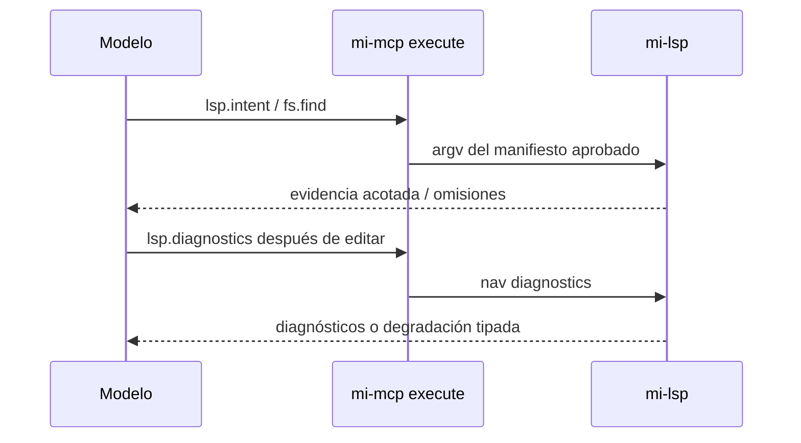

# FL-ALLHARNESS-001 — mi-lsp para todos los harness

## Objetivo
Cumple [[RS-ALLHARNESS-001]].

Fuente: pedido explícito de Gabriel `home/ideas/mi-lsp-para-todos-los-harness.md`, 2026-10-20; persona:herramientas-pocas-enganchables-20261020. Tipo de fuente: decisión del operador; no evidencia runtime.

## Alcance
El flujo cubre la carga de la misma skill, el uso de intent u operaciones literales, la proyección de aliases aprobados, los diagnostics posteriores a edición y la conservación de resultados parciales, presupuestos y errores tipados.

## Actores
Los participantes del flujo son el Modelo, `mi-mcp execute` y `mi-lsp`, tal como se representan en la secuencia existente.

## Pre/postcondiciones
La precondición es que el harness cargue la skill y descubra el subconjunto de `mi-lsp models`; el resultado conserva evidencia acotada u omisiones y permite solicitar diagnostics después de editar.

## Secuencia

1. El harness carga la misma skill y descubre el subconjunto de `mi-lsp models`.
2. Un objetivo usa intent; una operación literal usa lectura, búsqueda o referencias directamente.
3. execute proyecta aliases del manifiesto aprobado a sandbox; el padre conserva permisos y mappings v2.
4. Tras editar, el modelo pide diagnostics; nombres de archivos se buscan con find sin índice.
5. Resultados parciales, presupuestos y errores tipados se conservan; catálogo completo/help solo si hace falta.



## Restricciones ADR
No se declaran restricciones ADR adicionales en la decisión fuente.

[[RF-ALLHARNESS-001]] · [[CT-ALLHARNESS-001]]

Búsqueda de archivos: [[RF-HARNESS-FIND-001]], [[TP-HARNESS-FIND-001]] y [[TECH-HARNESS-FIND-001]], entregados por el dueño findfiles.

Diagnósticos: [[RF-HARNESS-DIAG-001]], [[TP-HARNESS-DIAG-001]] y [[TECH-HARNESS-DIAG-001]], entregados por el dueño diagnostics. Contrato JSON `diagnostics/v1`; fuente semántica real, sin fallback textual ni builds.

```yaml
harness_protocol: SDD-HARNESS-v1
id: FL-ALLHARNESS-001
kind: flow
audience: llm-first
imports:
  - .docs/wiki/00_governance.md
  - .docs/wiki/02_outcomes/RS-ALLHARNESS-001.md
  - .docs/wiki/05_requirements/RF-HARNESS-FIND-001.md
  - .docs/wiki/05_requirements/RF-HARNESS-DIAG-001.md
exports:
  - FL-ALLHARNESS-001
agent_must_read:
  - .docs/wiki/04_flows/FL-ALLHARNESS-001.md
agent_may_edit:
  - .docs/wiki/04_flows/FL-ALLHARNESS-001.md
agent_must_not_edit:
  - .docs/wiki/05_requirements/RF-HARNESS-FIND-001.md
  - .docs/wiki/05_requirements/RF-HARNESS-DIAG-001.md
  - .docs/wiki/06_tests/TP-HARNESS-FIND-001.md
  - .docs/wiki/06_tests/TP-HARNESS-DIAG-001.md
verify:
  - .docs/wiki/06_tests/TP-ALLHARNESS-001.md#Casos
stop_if:
  - harness_verdict=BLOCKED
  - flow_scope_or_acceptance_would_change
evidence:
  - .docs/wiki/04_flows/FL-ALLHARNESS-001.md
  - .docs/wiki/06_tests/TP-ALLHARNESS-001.md
  - .docs/wiki/05_requirements/RF-ALLHARNESS-001.md
```
