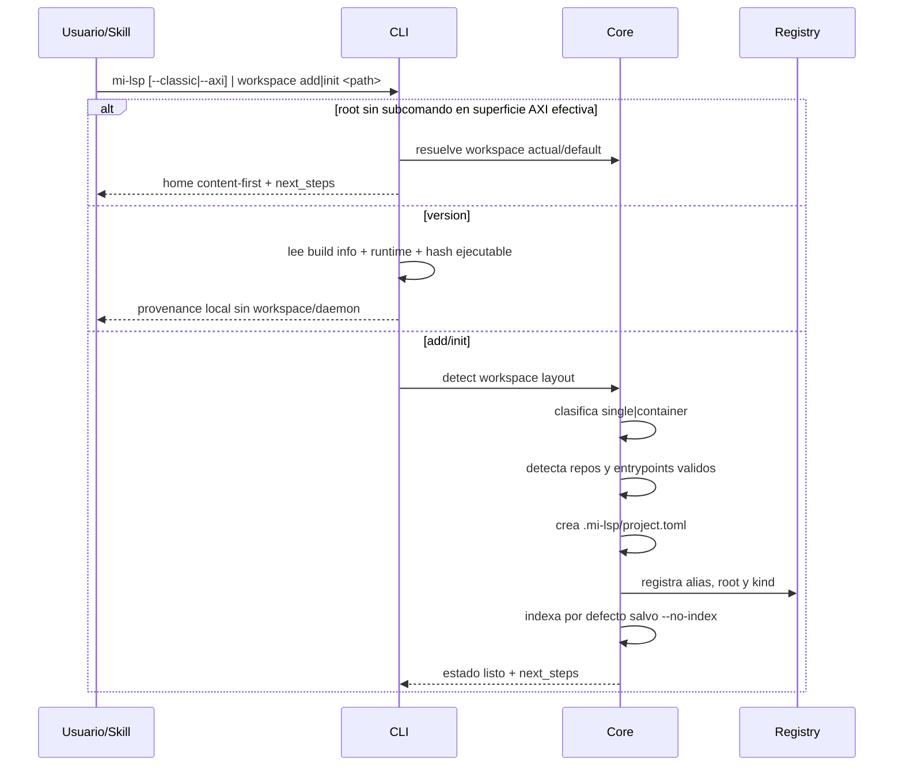

## Objetivo

Registrar o inicializar un workspace `single` o `container` y dejar lista su topología repo-local para indexación, `nav ask` y consultas posteriores. También cubre el home content-first del root command, la guia preview-first de onboarding/discovery cuando la superficie entra en AXI efectivo por default o por override explícito, y la comprobacion local de provenance del binario con `mi-lsp version`.

### 1. Objetivo
Registrar o inicializar un workspace `single` o `container` y dejar lista su topología repo-local para indexación, `nav ask` y consultas posteriores. También cubre el home content-first del root command, la guia preview-first de onboarding/discovery cuando la superficie entra en AXI efectivo por default o por override explícito, y la comprobacion local de provenance del binario con `mi-lsp version`.

## Alcance

- In: deteccion de root, alias opcional, clasificación `single|container`, deteccion de repos hijos y `entrypoints`, creacion de `.mi-lsp/`, persistencia de `project.toml` incluyendo `[[RF-WKS-008|canon]]` y `[canon_policy]`, alta en registry global mínimo, `workspace link <alias> --role` para asociar un workspace de canon, `init` como happy path corto, resolución centralizada del modo efectivo AXI/classic via defaults por superficie + `--axi` + `--classic` + `MI_LSP_AXI=1`, home content-first cuando se invoca `mi-lsp` sin subcomando salvo `--classic`, comando `version` sin workspace para provenance del ejecutable, `workspace which` como resolución de solo lectura del workspace efectivo y el ejecutable en uso sin mutar el registry, y la precedencia `workspace explicito > workspace por caller_cwd > last_workspace`.
- Out: descarga automática de worker y setup remoto.

### 2. Alcance y exclusiones
- In: deteccion de root, alias opcional, clasificación `single|container`, deteccion de repos hijos y `entrypoints`, creacion de `.mi-lsp/`, persistencia de `project.toml` incluyendo `[[RF-WKS-008|canon]]` y `[canon_policy]`, alta en registry global mínimo, `workspace link <alias> --role` para asociar un workspace de canon, `init` como happy path corto, resolución centralizada del modo efectivo AXI/classic via defaults por superficie + `--axi` + `--classic` + `MI_LSP_AXI=1`, home content-first cuando se invoca `mi-lsp` sin subcomando salvo `--classic`, comando `version` sin workspace para provenance del ejecutable, `workspace which` como resolución de solo lectura del workspace efectivo y el ejecutable en uso sin mutar el registry, y la precedencia `workspace explicito > workspace por caller_cwd > last_workspace`.
- Out: descarga automática de worker y setup remoto.

## Actores

Usuario o agente, CLI y core; backends y almacenes según la secuencia.

## Pre/postcondiciones

Workspace resoluble y entradas válidas. Las condiciones específicas, los resultados y las salidas de error se conservan en el detalle.

## Secuencia



### Secuencia principal

La secuencia contractual es el único diagrama de `## Secuencia`, derivado de los pasos vigentes de este flujo.

### 4. Alternativas y errores
- **Caso**: Path inválido; **Resultado**: error explícito sin side effects
- **Caso**: No se detecta stack compatible; **Resultado**: warning + rechazo
- **Caso**: Layout ambiguo; **Resultado**: se persiste la topología mínima y se exponen defaults claros
- **Caso**: Multiples aliases registrados para el mismo root; **Resultado**: la selección automática prioriza `project.name`, luego basename del root y deja warning visible
- **Caso**: Paths auxiliares (`.worktrees/`, ignores); **Resultado**: se omiten del bootstrap
- **Caso**: Entrypoints bajo `.docs/` o `template(s)`; **Resultado**: permanecen visibles en topología, pero no deben quedar como default semántico si existe una opcion real del repo
- **Caso**: Indexación falla; **Resultado**: registro exitoso con warning no fatal
- **Caso**: AXI sin workspace resoluble; **Resultado**: el home content-first cae a sugerencias de `init`, `workspace scan` y `workspace list` sin mutar estado

### 5. Datos utilizados
- Repo-local: `.mi-lsp/project.toml`
- Repo-local opcional: `.docs/wiki/_mi-lsp/read-model.toml`
- Global: `~/.mi-lsp/registry.toml`
- Estados: `detected`, `registered`, `single|container`

## Restricciones ADR

Confiabilidad, rendimiento, memoria, portabilidad y experiencia de desarrollo, en ese orden. La admisión Kotlin sigue limitada por ADR-KOTLIN-GRAPH-ADMISSION-V1; no concede promoción runtime.

```yaml
harness_protocol: SDD-HARNESS-v1
id: FL-BOOT-01
kind: flow
audience: llm-first
imports:
  - .docs/wiki/00_governance.md
  - .docs/wiki/02_outcomes/RS-MILSP-RUNTIME.md
exports:
  - FL-BOOT-01
agent_must_read:
  - .docs/wiki/04_flows/FL-BOOT-01.md
agent_may_edit:
  - .docs/wiki/04_flows/FL-BOOT-01.md
agent_must_not_edit:
  - .docs/wiki/05_requirements/RF-WKS-001.md
  - .docs/wiki/06_tests/TP-WKS.md
verify:
  - .docs/wiki/06_tests/TP-WKS.md#Casos
stop_if:
  - harness_verdict=BLOCKED
  - flow_scope_or_acceptance_would_change
evidence:
  - .docs/wiki/04_flows/FL-BOOT-01.md
  - .docs/wiki/06_tests/TP-WKS.md
  - .docs/wiki/05_requirements/RF-WKS-001.md
```
