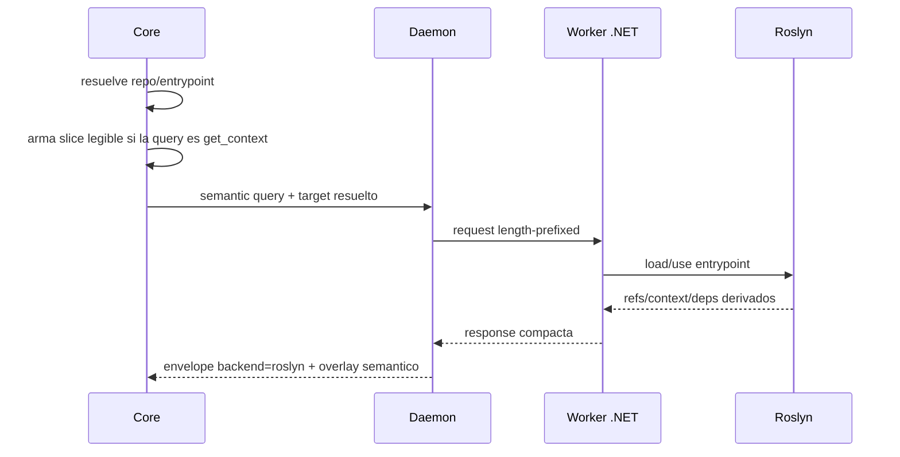

## Objetivo

Resolver una consulta semántica profunda C# usando un worker Roslyn enrutable al repo hijo y entrypoint correctos.

### 1. Objetivo
Resolver una consulta semántica profunda C# usando un worker Roslyn enrutable al repo hijo y entrypoint correctos.

## Alcance

- In: `find_refs`, `get_context`, `get_overview`, `get_deps`, selectors `--repo`, `--entrypoint`, `--solution`, `--project`, runtime pool por entrypoint.
- Out: fanout semántico automático sobre todos los repos hijos y edicion semantica.

### 2. Alcance y exclusiones
- In: `find_refs`, `get_context`, `get_overview`, `get_deps`, selectors `--repo`, `--entrypoint`, `--solution`, `--project`, runtime pool por entrypoint.
- Out: fanout semántico automático sobre todos los repos hijos y edicion semantica.

## Actores

Usuario o agente, CLI y core; backends y almacenes según la secuencia.

## Pre/postcondiciones

Workspace resoluble y entradas válidas. Las condiciones específicas, los resultados y las salidas de error se conservan en el detalle.

## Secuencia

### Secuencia principal

La secuencia contractual es el único diagrama de `## Secuencia`, derivado de los pasos vigentes de este flujo.

### 4. Alternativas y errores
- **Caso**: Worker no instalado; **Resultado**: error accionable `mi-lsp worker install`
- **Caso**: Query ambigua en workspace `container`; **Resultado**: `backend=router`, candidatos y `next_hint`
- **Caso**: `--repo` o `--entrypoint` explícito; **Resultado**: bypass de heuristica y routing directo
- **Caso**: Daemon ausente; **Resultado**: el core puede ejecutar el mismo flujo en modo directo
- **Caso**: Primer candidato Roslyn falla por bootstrap; **Resultado**: retry único con el siguiente candidato `bundle -> installed -> dev-local`; si no recupera, error accionable
- **Caso**: Roslyn no responde en `get_context`; **Resultado**: el core conserva `slice_text` y degrada a `catalog` o `text` con warning

### 5. Datos utilizados
- request/response stdio
- workspace Roslyn cargado por `entrypoint_path`
- estados: `worker hot`, `worker cold`, `ambiguous`
- slice textual local construido por el core

## Restricciones ADR

Confiabilidad, rendimiento, memoria, portabilidad y experiencia de desarrollo, en ese orden. La admisión Kotlin sigue limitada por ADR-KOTLIN-GRAPH-ADMISSION-V1; no concede promoción runtime.
