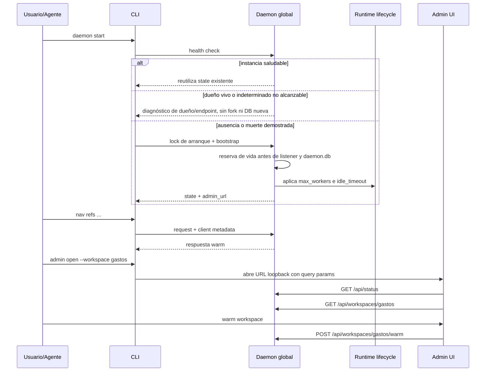

## Objetivo

Mantener un daemon global opcional por usuario que reduzca latencia warm, comparta estado entre clientes locales y exponga una vista de gobernanza workspace-first sin convertirse en requisito operativo para la CLI. El input visible sigue siendo `workspace` (alias/path), mientras que la identidad canónica de runtime y analytics es `workspace_root`.

### 1. Objetivo
Mantener un daemon global opcional por usuario que reduzca latencia warm, comparta estado entre clientes locales y exponga una vista de gobernanza workspace-first sin convertirse en requisito operativo para la CLI. El input visible sigue siendo `workspace` (alias/path), mientras que la identidad canónica de runtime y analytics es `workspace_root`.

## Alcance

- In: start/stop/status, named pipe/unix socket, runtime pool por `(workspace_root, backend_type, entrypoint_id)`, LRU, idle eviction, governance UI loopback, telemetry local, warm seguro via admin API, logs locales, export summary con recomendaciones sanitizadas.
- Out: auth remota, cluster multi-host, observabilidad externa, acciones destructivas desde la UI.

### 2. Alcance y exclusiones
- In: start/stop/status, named pipe/unix socket, runtime pool por `(workspace_root, backend_type, entrypoint_id)`, LRU, idle eviction, governance UI loopback, telemetry local, warm seguro via admin API, logs locales, export summary con recomendaciones sanitizadas.
- Out: auth remota, cluster multi-host, observabilidad externa, acciones destructivas desde la UI.

## Actores

- Desarrollador/agente: administra `daemon start|stop|status`, `admin open|status` y acciones seguras de gobernanza.
- CLI: detecta disponibilidad, decide fallback, envia `client_name/session_id` y arma deep-links consistentes con un `workspace` visible.
- Daemon: enruta requests, resuelve `workspace_root`, administra runtimes, registra telemetria y publica la vista admin.
- Admin UI: consume endpoints loopback y presenta runtimes, accesos, logs y acciones seguras preservando el foco por `workspace` sin perder la clave canonica.

### 3. Actores y responsabilidades
- Desarrollador/agente: administra `daemon start|stop|status`, `admin open|status` y acciones seguras de gobernanza.
- CLI: detecta disponibilidad, decide fallback, envia `client_name/session_id` y arma deep-links consistentes con un `workspace` visible.
- Daemon: enruta requests, resuelve `workspace_root`, administra runtimes, registra telemetria y publica la vista admin.
- Admin UI: consume endpoints loopback y presenta runtimes, accesos, logs y acciones seguras preservando el foco por `workspace` sin perder la clave canonica.

## Pre/postcondiciones

- Binario `mi-lsp` disponible.
- Permisos suficientes para crear pipe/socket local y escribir state/telemetry en `~/.mi-lsp/daemon/`.
- Si el usuario abre la UI, el browser del sistema debe poder resolver `127.0.0.1`.

### 4. Precondiciones
- Binario `mi-lsp` disponible.
- Permisos suficientes para crear pipe/socket local y escribir state/telemetry en `~/.mi-lsp/daemon/`.
- Si el usuario abre la UI, el browser del sistema debe poder resolver `127.0.0.1`.

### 5. Postcondiciones
- Daemon operativo o fallback garantizado.
- Instancia compartida reutilizable entre terminales y agentes del mismo usuario.
- Admin URL disponible por `daemon status` / `admin status`.
- La UI local puede mostrar estado, activity, logs y ejecutar `warm workspace` sin salir del navegador, preservando alias/path visibles y agrupando internamente por `workspace_root`.
- Diagnósticos administrativos como `worker status` mantienen el mismo envelope visible con y sin daemon; solo cambia el estado vivo observado.
- El daemon expone diagnóstico de performance suficiente para presupuestos de agentes: proceso (`working_set_bytes`, `private_bytes`, `handle_count`, `thread_count`), watchers (`mode`, roots/dirs activos, eventos pendientes) y backpressure de requests pesadas.

## Secuencia

### Secuencia principal

La secuencia contractual es el único diagrama de `## Secuencia`, derivado de los pasos vigentes de este flujo.

### Flujo objetivo de servicio y drenaje — OPEN

1. El servicio inicia su reloj idle y admite trabajo semántico o jobs reales; solo ese trabajo lo mantiene activo. Probes, conexiones o recursos cacheados no lo renuevan.
2. Al finalizar cada trabajo admitido comienza una ventana idle fresca. La cancelación del peer termina su request, no el servicio ni sus demás trabajos.
3. Ante idle o stop, un único dueño cierra admisiones y drena handlers, jobs y recursos; mantiene DB, lease y fence hasta el join efectivo. Un deadline del llamador devuelve incompleto mientras el dueño continúa autónomamente. La actualización conserva su fence conjunto y cancelación más join del scheduler A15.
4. El supervisor consulta el lease sin efectos laterales; `wait_tree` cancela solo el árbol del comando. La independencia del servicio frente al Job Windows y los 30 asserts B22 requieren prueba real, aún OPEN; flags de creación no son prueba.
5. El almacén admite o rechaza telemetría según el umbral WAL, con checkpoint y espera bounded; errores y busy se informan, sin prometer techo físico de disco. Integración de health y prueba de extremo a extremo siguen OPEN.

### 7. Alternativas y errores
- **Caso**: Daemon no inicia; **Resultado**: la CLI sigue usable sin el
- **Caso**: Segundo `daemon start`; **Resultado**: devuelve la instancia ya viva si responde; si el dueño vive o no puede confirmarse muerto pero su endpoint es inaccesible, devuelve diagnóstico y no crea otro daemon.
- **Caso**: Constructores concurrentes, mismo almacenamiento y endpoints diferentes; **Resultado**: sólo uno conserva la reserva de vida hasta cerrar DB. Los fallos de construcción liberan únicamente su propia reserva; no se reclama por edad un dueño vivo/indeterminado.
- **Caso**: Binarios antiguos ya duplicados; **Resultado**: la mitigación no los mata ni acredita su drenaje. El supervisor recarga los consumidores actualizados; CPU/idle/WAL requieren evidencia y cierre propios.
- **Caso**: Límite de runtimes alcanzado; **Resultado**: eviction LRU
- **Caso**: Runtime idle > timeout; **Resultado**: runtime liberado
- **Caso**: Presion de requests pesadas > `max_inflight`; **Resultado**: envelope `ok=false` con warning `daemon/backpressure_busy` y retry accionable
- **Caso**: Watchers deshabilitados o lazy; **Resultado**: el daemon sigue operativo; el re-index incremental por watcher queda apagado o se activa solo al tocar un workspace
- **Caso**: alias/path ambiguo para un mismo root; **Resultado**: el daemon conserva el foco visible y normaliza a `workspace_root` para runtime/telemetria
- **Caso**: `tsserver` ausente; **Resultado**: warning y fallback semantico/textual
- **Caso**: `admin_url` no responde; **Resultado**: error explícito para `admin` y `daemon open`
- **Caso**: log aun inexistente; **Resultado**: panel de logs y endpoint devuelven warning no fatal

### 9. Datos utilizados
- named pipe / unix socket local
- `~/.mi-lsp/daemon/state.json`
- `~/.mi-lsp/daemon/daemon.db`
- `{repoRoot}/.mi-lsp/daemon.log`
- metricas de worker/runtime status
- estados: daemon down, daemon up, runtime active, runtime evicted

## Restricciones ADR

Confiabilidad, rendimiento, memoria, portabilidad y experiencia de desarrollo, en ese orden. La admisión Kotlin sigue limitada por ADR-KOTLIN-GRAPH-ADMISSION-V1; no concede promoción runtime.

### 8. Corte de arquitectura
`daemon/server.go`, `daemon/client.go`, `daemon/lifecycle.go`, `daemon/admin.go`, `daemon/state_store.go`.

### 11. Bottlenecks, risks, and selected mitigations

- Riesgo: daemon como punto único de falla.
- Mitigacion: bypass automático y contrato CLI independiente.
- Riesgo: demasiados runtimes vivos.
- Mitigacion: `max_workers` (default 8), LRU e `idle_timeout`; en Linux los workers se atan al daemon con `Pdeathsig=SIGKILL`.
- Riesgo: demasiados watchers o aliases duplicados consumen handles/RAM.
- Mitigacion: `watch_mode=lazy` por defecto, dedupe por root canónico y cap LRU con `max_watched_roots`.
- Riesgo: concurrencia de agentes satura el daemon.
- Mitigacion: lock global de auto-start, health recheck, y backpressure `MI_LSP_DAEMON_MAX_INFLIGHT`.
- Riesgo: drift entre clientes o aliases distintos del mismo repo.
- Mitigacion: metadata `client_name/session_id` + telemetry local con identidad canónica por `workspace_root`.
- Riesgo: UI poco accionable.
- Mitigacion: vista workspace-first, filtros, drawer, panel de logs y acciones seguras.
