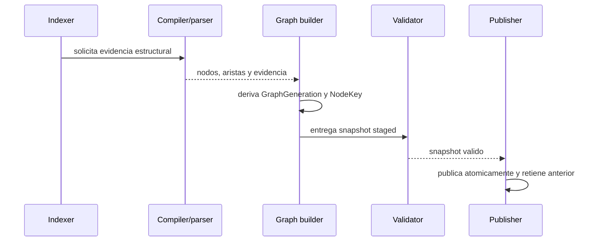

## Objetivo

Generar, validar y publicar un grafo nativo desde evidencia estructural disponible en los backends del workspace. La generación es identificable como `GraphGeneration`, los nodos usan `NodeKey` estable y las aristas conservan evidencia suficiente para explicar su origen.

### 1. Objetivo
Generar, validar y publicar un grafo nativo desde evidencia estructural disponible en los backends del workspace. La generación es identificable como `GraphGeneration`, los nodos usan `NodeKey` estable y las aristas conservan evidencia suficiente para explicar su origen.

## Alcance

- In: compilador/parser disponible, normalización de nodos y aristas, validación de identidad, staging, publicación atomica y conservacion de la generación anterior para rollback; `index --docs-only` puede publicar un grafo documental desde markdown canónico (`wiki/`, `bibliotecas/`, `.docs/wiki/`) y recorre roots `[[RF-WKS-008|canon]]` declarados sin batches de compilador.
- Out: consultas, extensiones, RF/TP y cambios de autoridad documental; se derivan en olas posteriores.

### 2. Alcance y exclusiones
- In: compilador/parser disponible, normalización de nodos y aristas, validación de identidad, staging, publicación atomica y conservacion de la generación anterior para rollback; `index --docs-only` puede publicar un grafo documental desde markdown canónico (`wiki/`, `bibliotecas/`, `.docs/wiki/`) y recorre roots `[[RF-WKS-008|canon]]` declarados sin batches de compilador.
- Out: consultas, extensiones, RF/TP y cambios de autoridad documental; se derivan en olas posteriores.

## Actores

Usuario o agente, CLI y core; backends y almacenes según la secuencia.

## Pre/postcondiciones

- Preconditions: workspace con entrypoint resoluble y backend estructural que devuelva evidencia o `unresolved` explícito, o corpus docs-only con markdown canónico para el slice documental.
- Postconditions: generación identificable; cada nodo tiene `NodeKey` y origen; una publicación fallida no reemplaza el snapshot activo.

### 3. Precondiciones y postcondiciones
- Preconditions: workspace con entrypoint resoluble y backend estructural que devuelva evidencia o `unresolved` explícito, o corpus docs-only con markdown canónico para el slice documental.
- Postconditions: generación identificable; cada nodo tiene `NodeKey` y origen; una publicación fallida no reemplaza el snapshot activo.

## Secuencia

### Secuencia principal

La secuencia contractual es el único diagrama de `## Secuencia`, derivado de los pasos vigentes de este flujo.

### 5. Alternativas y errores
- **Caso**: Backend no disponible; **Resultado**: no se publica; warning con el motivo
- **Caso**: Identidad inválida o colision; **Resultado**: staging rechazado; generación anterior permanece activa
- **Caso**: Evidencia incompleta; **Resultado**: se conserva como `unresolved`; no se inventa arista semántica
- **Caso**: Fallo durante publish; **Resultado**: rollback al puntero anterior y cleanup del staging

## Restricciones ADR

Confiabilidad, rendimiento, memoria, portabilidad y experiencia de desarrollo, en ese orden. La admisión Kotlin sigue limitada por ADR-KOTLIN-GRAPH-ADMISSION-V1; no concede promoción runtime.

### 6. Invariantes
1. El compilador/parser es la fuente primaria; el texto solo aporta metadata auxiliar.
2. `NodeKey` no depende de posiciones inestables cuando existe identidad semantica.
3. Publicación all-or-nothing; siempre se identifica la generación activa.
4. Query no muta el snapshot ni el catalogo.
5. No se afirma performance, p95 o RSS sin medicion reproducible en el gate correspondiente.
