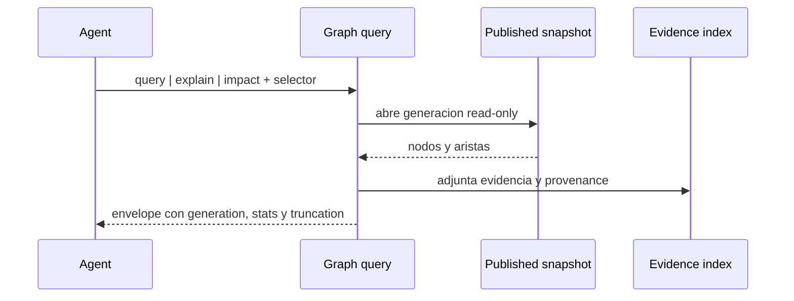

## Objetivo

Consultar una generación publicada y explicar caminos de aristas o el impacto alcanzable sin mutar el índice, el catálogo ni el snapshot consultado.

### 1. Objetivo
Consultar una generación publicada y explicar caminos de aristas o el impacto alcanzable sin mutar el índice, el catálogo ni el snapshot consultado.

## Alcance

- In: operaciones read-only `query`, `explain` e `impact`; selección explícita de `GraphGeneration`; límites de profundidad, cantidad y tokens; evidencia y warnings deterministas.
- Out: edicion semántica, reconstruccion implicita, publicación, escritura del grafo y RF/TP.

### 2. Alcance y exclusiones
- In: operaciones read-only `query`, `explain` e `impact`; selección explícita de `GraphGeneration`; límites de profundidad, cantidad y tokens; evidencia y warnings deterministas.
- Out: edicion semántica, reconstruccion implicita, publicación, escritura del grafo y RF/TP.

## Actores

Usuario o agente, CLI y core; backends y almacenes según la secuencia.

## Pre/postcondiciones

- Preconditions: existe una generación publicada y el selector identifica un nodo o patron sin ambigüedad no resuelta.
- Postconditions: la respuesta identifica la generación consultada, devuelve resultados truncables y no cambia archivos ni estado del grafo.

### 3. Precondiciones y postcondiciones
- Preconditions: existe una generación publicada y el selector identifica un nodo o patron sin ambigüedad no resuelta.
- Postconditions: la respuesta identifica la generación consultada, devuelve resultados truncables y no cambia archivos ni estado del grafo.

## Secuencia

### Secuencia principal

La secuencia contractual es el único diagrama de `## Secuencia`, derivado de los pasos vigentes de este flujo.

### 5. Alternativas y errores
- **Caso**: Generación ausente; **Resultado**: error accionable; no fallback que invente grafo
- **Caso**: Selector ambiguo; **Resultado**: `backend=router`, candidatos y `next_hint`
- **Caso**: Evidencia unresolved; **Resultado**: resultado marcado con warning, sin elevar confianza
- **Caso**: Budget agotado; **Resultado**: `truncated=true` y continuation determinista

## Restricciones ADR

Confiabilidad, rendimiento, memoria, portabilidad y experiencia de desarrollo, en ese orden. La admisión Kotlin sigue limitada por ADR-KOTLIN-GRAPH-ADMISSION-V1; no concede promoción runtime.

### 6. Invariantes
1. Query, explain e impact son solo lectura.
2. La generación consultada se informa en toda respuesta no vacia.
3. La profundidad y el presupuesto son límites de salida, no licencia para scan ilimitado.
4. La evidencia se conserva junto al camino; no se presentan inferencias como hechos.
5. Las respuestas siguen siendo validas aunque el daemon no este activo.
