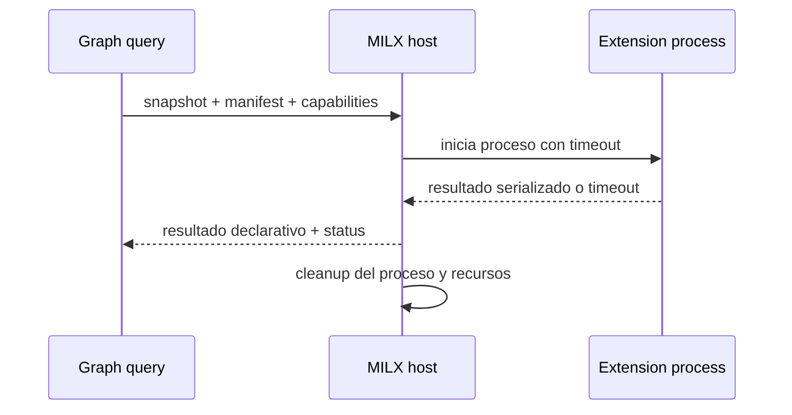

## Objetivo

Ejecutar extensiones declarativas `MILX-v1` sobre un snapshot publicado mediante un host aislado, con capabilities explícitas, timeout, salida serializada y tolerancia a fallos.

### 1. Objetivo
Ejecutar extensiones declarativas `MILX-v1` sobre un snapshot publicado mediante un host aislado, con capabilities explícitas, timeout, salida serializada y tolerancia a fallos.

## Alcance

- In: proceso separado, snapshot read-only, allowlist de capabilities, límites de tiempo/salida, serializacion de resultado y telemetria de estado.
- Out: MCP, red implicita, memoria compartida, escritura del índice principal, mutación del grafo y RF/TP.

### 2. Alcance y exclusiones
- In: proceso separado, snapshot read-only, allowlist de capabilities, límites de tiempo/salida, serializacion de resultado y telemetria de estado.
- Out: MCP, red implicita, memoria compartida, escritura del índice principal, mutación del grafo y RF/TP.

## Actores

Usuario o agente, CLI y core; backends y almacenes según la secuencia.

## Pre/postcondiciones

- Preconditions: extension valida, version MILX-v1 soportada y snapshot publicado seleccionado.
- Postconditions: resultado declarativo o estado de timeout/fallo; el core continua disponible y el grafo primario no cambia.

### 3. Precondiciones y postcondiciones
- Preconditions: extension valida, version MILX-v1 soportada y snapshot publicado seleccionado.
- Postconditions: resultado declarativo o estado de timeout/fallo; el core continua disponible y el grafo primario no cambia.

## Secuencia



### Secuencia principal

La secuencia contractual es el único diagrama de `## Secuencia`, derivado de los pasos vigentes de este flujo.

### 5. Alternativas y errores
- **Caso**: Capability no permitida; **Resultado**: rechazo antes de ejecutar
- **Caso**: Timeout; **Resultado**: status timeout; no falla la consulta ni el core
- **Caso**: Salida invalida/excesiva; **Resultado**: resultado descartado y warning acotado
- **Caso**: Error del proceso; **Resultado**: host terminado; el core continua disponible y se conserva el snapshot activo

### 6. Observabilidad

- Cada ejecución informa `GraphGeneration`, extension/version, capabilities solicitadas, status, duracion, tamano de salida y resultado del cleanup.
- Los estados observables son `accepted`, `rejected`, `timeout` y `failed`; los warnings son acotados, deterministas y no exponen payloads arbitrarios.
- El resultado conserva provenance del snapshot y referencias suficientes para explicar cualquier relacion de grafo o impacto wiki-code; una inferencia se marca como tal y no se presenta como hecho del compilador.
- `client_name` y `session_id` pueden acompañar la telemetria como metadatos operativos de trazabilidad, sin convertirse en autoridad funcional ni habilitar red implicita.

### 8. Aceptacion y trazabilidad

- Aceptar solo manifests MILX-v1 válidos con capabilities allowlisted y snapshot publicado seleccionado.
- Verificar rechazo previo para capabilities no permitidas, timeout/fallo aislado, descarte de salida inválida o excesiva y cleanup sin mutación del core.
- Mantener explicable la cadena snapshot -> resultado -> evidencia, incluyendo referencias wiki-code cuando correspondan y warnings explícitos para estados unresolved.
- La trazabilidad de este flujo se completa en `RF-GPH-010`, `RF-GPH-011`, `TP-GPH-006` y `TP-GPH-007`; `00_governance.md`, alcance, arquitectura y este flujo conservan autoridad sobre los contratos derivados.

## Restricciones ADR

Confiabilidad, rendimiento, memoria, portabilidad y experiencia de desarrollo, en ese orden. La admisión Kotlin sigue limitada por ADR-KOTLIN-GRAPH-ADMISSION-V1; no concede promoción runtime.

### 7. Invariantes
1. El snapshot publicado es la única entrada de datos y se abre en modo read-only.
2. El host corre fuera del proceso principal, sin memoria compartida, MCP, red implicita ni escritura del índice o grafo primario.
3. Las capabilities se validan antes de iniciar; timeout, crash, salida inválida o exceso de salida solo afectan a la extension.
4. El cleanup de proceso y recursos ocurre aun cuando la extension falle; la generación activa permanece sin cambios.
5. Toda respuesta es bounded, generation-aware y provenance-bearing; no se afirma completitud, impacto ni performance sin evidencia reproducible.

```yaml
harness_protocol: SDD-HARNESS-v1
id: FL-GPH-03
kind: flow
audience: llm-first
imports:
  - .docs/wiki/00_governance.md
  - .docs/wiki/02_outcomes/RS-MILSP-GRAPH.md
exports:
  - FL-GPH-03
agent_must_read:
  - .docs/wiki/04_flows/FL-GPH-03.md
agent_may_edit:
  - .docs/wiki/04_flows/FL-GPH-03.md
agent_must_not_edit:
  - .docs/wiki/05_requirements/RF-GPH-003.md
  - .docs/wiki/06_tests/TP-GPH.md
verify:
  - .docs/wiki/06_tests/TP-GPH.md#Casos
stop_if:
  - harness_verdict=BLOCKED
  - flow_invariants_or_acceptance_would_change
  - partial_extension_output_is_called_complete
evidence:
  - .docs/wiki/04_flows/FL-GPH-03.md
  - .docs/wiki/06_tests/TP-GPH.md
  - .docs/wiki/05_requirements/RF-GPH-003.md
```
