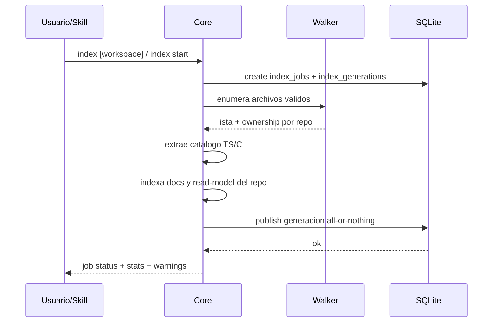

## Objetivo

Construir o refrescar el índice repo-local del workspace de manera incremental, determinista y con ownership por repo, incluyendo el corpus documental necesario para `nav ask`.

### 1. Objetivo
Construir o refrescar el índice repo-local del workspace de manera incremental, determinista y con ownership por repo, incluyendo el corpus documental necesario para `nav ask`.

## Alcance

- In: scan de archivos, respeto de ignores por defaults + `.gitignore` + `.milspignore` + `project.toml` honrando orden y re-includes negados, escritura en SQLite, ownership por `repo_id`, actualizacion por `content_hash`, indexación de docs `.md` incluyendo roots `[[RF-WKS-008|canon]]` en `index --docs-only`, warnings de ruido evidente.
- Out: persistencia semántica completa de refs y jerarquias C#.

### 2. Alcance y exclusiones
- In: scan de archivos, respeto de ignores por defaults + `.gitignore` + `.milspignore` + `project.toml` honrando orden y re-includes negados, escritura en SQLite, ownership por `repo_id`, actualizacion por `content_hash`, indexación de docs `.md` incluyendo roots `[[RF-WKS-008|canon]]` en `index --docs-only`, warnings de ruido evidente.
- Out: persistencia semántica completa de refs y jerarquias C#.

## Actores

Usuario o agente, CLI y core; backends y almacenes según la secuencia.

## Pre/postcondiciones

Workspace resoluble y entradas válidas. Las condiciones específicas, los resultados y las salidas de error se conservan en el detalle.

## Secuencia

### Secuencia principal

La secuencia contractual es el único diagrama de `## Secuencia`, derivado de los pasos vigentes de este flujo.

### 4. Alternativas y errores
- **Caso**: Archivo ignorado; **Resultado**: se omite silenciosamente
- **Caso**: Archivo fuera de repos detectados; **Resultado**: warning y asignacion al root del workspace
- **Caso**: Índice contaminado por ruido; **Resultado**: warning con sugerencia concreta para `.milspignore`
- **Caso**: Cambio en `.docs/wiki`, `README*`, `docs/` o `read-model.toml`; **Resultado**: el incremental degrada a full re-index
- **Caso**: `index.db` previo sin docs canónicos aunque la wiki existe; **Resultado**: `index` no responde `no changes detected`: degrada a full re-index para autocurar `doc_records`
- **Caso**: `--clean` activo; **Resultado**: se recompone el índice desde cero
- **Caso**: Proceso muere antes de publicar; **Resultado**: la transaccion SQLite revierte y queda activa la generación previa
- **Caso**: Lock con PID inexistente; **Resultado**: se recupera automáticamente antes de iniciar el nuevo job
- **Caso**: Job largo en catalogo/docs; **Resultado**: `index status` refresca `updated_at`, stage/path y contadores parciales
- **Caso**: `index cancel` sin `--force`; **Resultado**: marca cancelacion solicitada y el worker la respeta al volver al loop de indexación
- **Caso**: Diagnóstico de workspace/index; **Resultado**: `workspace doctor` puede consumir estado de índice para emitir `health` y `next_actions` sin modificar registry ni DB

### 5. Datos utilizados
- `.mi-lsp/index.db`
- tablas `workspace_repos`, `workspace_entrypoints`, `symbols`, `files`, `doc_records`, `doc_edges`, `doc_mentions`, `index_jobs`, `index_generations`, `workspace_meta`
- estados: sin índice, job queued/running/publishing/succeeded/failed/canceled, generación activa, índice con warnings de ruido; `index status` expone progreso vivo (`current_stage`, `current_path`, `files_total`, contadores), `index cancel --force` puede cortar un job colgado y liberar el workspace para reintento, y `publishing` debe quedar reservado al cierre final del job

## Restricciones ADR

Confiabilidad, rendimiento, memoria, portabilidad y experiencia de desarrollo, en ese orden. La admisión Kotlin sigue limitada por ADR-KOTLIN-GRAPH-ADMISSION-V1; no concede promoción runtime.
