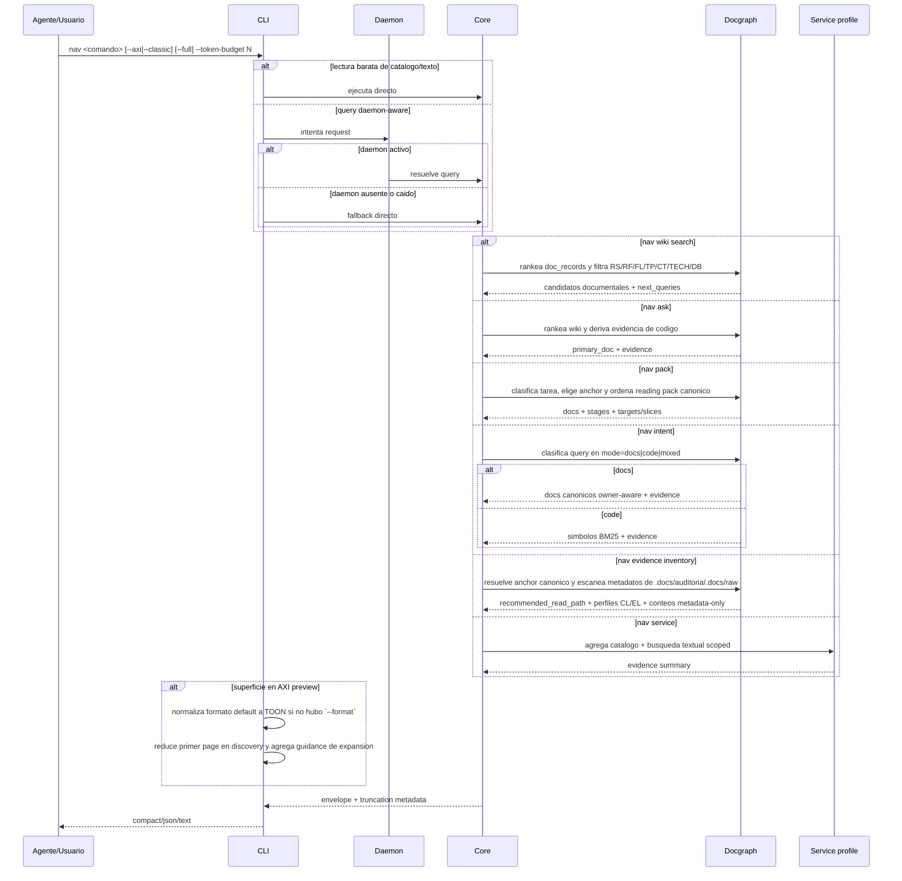

## Objetivo

Resolver una consulta con salida compacta, truncación determinista y fallback cuando el daemon o el backend semántico no estan disponibles. Las operaciones están disponibles desde la CLI. La puerta MCP local por stdio fue retirada el 2026-10-15; `mi-mcp` invoca el CLI por llamada. Incluye `nav wiki` como superficie dedicada para explorar RS/RF/FL/TP/CT/TECH/DB, `nav route` como selector canónico de bajo token para obtener el documento de anclaje y un mini reading pack antes de expandir con `nav ask` o `nav pack`, y `nav evidence inventory` como inventario preview-first de evidencia operacional antes de leer prompts, logs, turns o screenshots. También cubre `nav ask` como consulta docs-first guiada por wiki, `nav pack` como reading pack canónico para tareas spec-driven, `nav.intent` como superficie hibrida `docs|code`, la exploracion evidence-first de servicios, la regla de que las lecturas baratas de catalogo/texto no dependen del daemon, la disclosure preview-first de las superficies que caen en AXI efectivo, un bloque opcional `coach` para reruns/refinamientos explícitos y una capa tiny de continuidad/reentrada (`continuation`, `memory_pointer`) para que skills y harnesses sepan como seguir buscando.

### 1. Objetivo
Resolver una consulta con salida compacta, truncación determinista y fallback cuando el daemon o el backend semántico no estan disponibles. Las operaciones están disponibles desde la CLI. La puerta MCP local por stdio fue retirada el 2026-10-15; `mi-mcp` invoca el CLI por llamada. Incluye `nav wiki` como superficie dedicada para explorar RS/RF/FL/TP/CT/TECH/DB, `nav route` como selector canónico de bajo token para obtener el documento de anclaje y un mini reading pack antes de expandir con `nav ask` o `nav pack`, y `nav evidence inventory` como inventario preview-first de evidencia operacional antes de leer prompts, logs, turns o screenshots. También cubre `nav ask` como consulta docs-first guiada por wiki, `nav pack` como reading pack canónico para tareas spec-driven, `nav.intent` como superficie hibrida `docs|code`, la exploracion evidence-first de servicios, la regla de que las lecturas baratas de catalogo/texto no dependen del daemon, la disclosure preview-first de las superficies que caen en AXI efectivo, un bloque opcional `coach` para reruns/refinamientos explícitos y una capa tiny de continuidad/reentrada (`continuation`, `memory_pointer`) para que skills y harnesses sepan como seguir buscando.

## Alcance

- In: routing por backend, aplicación de `--token-budget`, `--max-items`, `--max-chars`, warnings de degradación, `nav suggest --tool <Read|Grep|Glob> --args <json>` como mapeo local puro sin daemon, transporte MCP local stdio (`initialize`, `ping`, `tools/list`, `tools/call`; retirado, ver RF-QRY-021), `nav wiki search|route|pack|trace`, `nav evidence inventory`, `nav service <path>`, `nav ask <question>`, `nav pack <task>`, `nav intent <question>`, `--axi`, `--classic`, `MI_LSP_AXI=1`, `--full` cuando el modo efectivo es AXI, el scorer owner-aware compartido para docs-first y la decisión centralizada de ejecutar directo `nav.find`, `nav.search`, `nav.wiki.search`, `nav.evidence.inventory`, `nav.intent`, `nav.symbols`, `nav.outline`, `nav.overview`, `nav.multi-read` y `nav pack`. En workspaces `container`, `find/search/intent` pueden acotar con `--repo`; si `nav.intent` clasifica la consulta como `docs`, ese selector se valida pero no redefine la lane documental. `nav ask|route|pack --repo` existe solo como compatibilidad guiada y no crea scope documental por repo. Cuando el request omite `--workspace`, la query se resuelve usando `caller_cwd` antes de `last_workspace`. Los docs outcome `RS-*` participan como layer `RS` y stage `outcome` entre `scope` y `architecture` cuando la gobernanza lo declara.
- Out: edicion/refactor, respuestas con blobs de código completos y score fuerte de completitud.

La puerta `mi-lsp mcp` (proceso local JSON-RPC/NDJSON por stdio) fue retirada el 2026-10-15. `mi-mcp` ejecuta el CLI por cada llamada, así que las reglas de workspace y salida compacta son las de la CLI.

### 2. Alcance y exclusiones
- In: routing por backend, aplicación de `--token-budget`, `--max-items`, `--max-chars`, warnings de degradación, `nav suggest --tool <Read|Grep|Glob> --args <json>` como mapeo local puro sin daemon, transporte MCP local stdio (`initialize`, `ping`, `tools/list`, `tools/call`; retirado, ver RF-QRY-021), `nav wiki search|route|pack|trace`, `nav evidence inventory`, `nav service <path>`, `nav ask <question>`, `nav pack <task>`, `nav intent <question>`, `--axi`, `--classic`, `MI_LSP_AXI=1`, `--full` cuando el modo efectivo es AXI, el scorer owner-aware compartido para docs-first y la decisión centralizada de ejecutar directo `nav.find`, `nav.search`, `nav.wiki.search`, `nav.evidence.inventory`, `nav.intent`, `nav.symbols`, `nav.outline`, `nav.overview`, `nav.multi-read` y `nav pack`. En workspaces `container`, `find/search/intent` pueden acotar con `--repo`; si `nav.intent` clasifica la consulta como `docs`, ese selector se valida pero no redefine la lane documental. `nav ask|route|pack --repo` existe solo como compatibilidad guiada y no crea scope documental por repo. Cuando el request omite `--workspace`, la query se resuelve usando `caller_cwd` antes de `last_workspace`. Los docs outcome `RS-*` participan como layer `RS` y stage `outcome` entre `scope` y `architecture` cuando la gobernanza lo declara.
- Out: edicion/refactor, respuestas con blobs de código completos y score fuerte de completitud.

La puerta `mi-lsp mcp` (proceso local JSON-RPC/NDJSON por stdio) fue retirada el 2026-10-15. `mi-mcp` ejecuta el CLI por cada llamada, así que las reglas de workspace y salida compacta son las de la CLI.

## Actores

- Skill/Agente o desarrollador: dispara comando `nav`.
- CLI: normaliza flags, decide routing directo vs daemon y formatea respuesta final.
- Daemon/Core: enruta a backend y produce envelope para queries daemon-aware.
- Docgraph/read-model: rankea wiki y conecta docs con codigo.
- Service exploration profile: agrega evidencia de catálogo y texto scoped a un path.

### 3. Actores y responsabilidades
- Skill/Agente o desarrollador: dispara comando `nav`.
- CLI: normaliza flags, decide routing directo vs daemon y formatea respuesta final.
- Daemon/Core: enruta a backend y produce envelope para queries daemon-aware.
- Docgraph/read-model: rankea wiki y conecta docs con codigo.
- Service exploration profile: agrega evidencia de catálogo y texto scoped a un path.

## Pre/postcondiciones

- Workspace resoluble.
- Comando `nav` valido.
- Path de servicio existente cuando se usa `nav service`.
- Corpus documental accesible cuando se usa `nav ask`.

### 4. Precondiciones
- Workspace resoluble.
- Comando `nav` valido.
- Path de servicio existente cuando se usa `nav service`.
- Corpus documental accesible cuando se usa `nav ask`.

### 5. Postcondiciones
- El usuario recibe un envelope estable y compacto.
- Si hubo truncación, timeout con parciales o degradacion, queda explicitado en `warnings`/`next_hint`; cuando existe una acción de continuidad fuerte, el envelope puede agregar `coach` (por ejemplo `search_timeout`).
- Las superficies calientes pueden agregar `continuation` machine-readable y `memory_pointer` wiki-aware para dejar un proximo paso o una pista de reentrada con muy bajo costo de tokens.
- Si se uso `nav service`, la respuesta contiene evidencia estructurada y no un veredicto fuerte de completitud.
- Si se uso `nav ask`, la respuesta deja visible documento primario, evidencia documental, evidencia de código y siguientes pasos; si la evidencia es fina o cayo a fallback textual, puede agregar `coach`.
- Si se uso `nav pack`, la respuesta deja visible el reading pack canónico, sus stages y sus targets o slices según preview/full.
- Si se uso `nav wiki search`, la respuesta deja visible candidatos documentales por capa y `next_queries` concretos para pack/trace/multi-read/ask.
- Si se uso `nav evidence inventory`, la respuesta deja visible anchor canónico, `recommended_read_path`, perfiles CL/EL y raices de evidencia con conteos/bytes sin contenido raw.
- Si se uso `nav intent`, la respuesta deja visible `mode=docs|code|mixed`: capability-like -> docs canónicos owner-aware; symbol-like -> ranking BM25 de catálogo; pregunta con señales de código -> `mixed` (código fuerte primero, luego docs), con `result_kind` y `origin` por item.
- Una superficie con fallback (`nav find`, `nav refs`) nunca deja un vacio falso: o responde con la via alternativa marcada `degraded=true` + `reason` + `fallback_used`, o devuelve un vacio verificado con `reason=no_matches`.
- Si se uso una lectura barata de catalogo/texto, la respuesta no queda bloqueada por health del daemon.
- Si el workspace se resolvio por fallback (`same-root alias ambiguity` o `last_workspace`), la respuesta deja warning visible con el alias seleccionado.

## Secuencia



### Secuencia principal

La secuencia contractual es el único diagrama de `## Secuencia`, derivado de los pasos vigentes de este flujo.

### 7. Alternativas y errores
- **Caso**: Daemon caido; **Resultado**: fallback directo para queries daemon-aware; las lecturas baratas siguen directas
- **Caso**: Operación de catalogo/texto (`find/search/intent/symbols/outline/overview/multi-read/pack`); **Resultado**: ejecuta directo y no depende de health del daemon
- **Caso**: Presupuesto agotado; **Resultado**: `truncated=true` + `next_hint`
- **Caso**: Backend degradado (`tsserver`, `pyright` o `gopls` ausente; worker Roslyn no disponible); **Resultado**: `warnings` explícitos y backend alternativo `catalog|text`
- **Caso**: `nav find` sin catálogo publicado, ilegible o con esquema roto; **Resultado**: `ok=true`, `backend=text`, items `origin=text`, `degraded=true`, `reason=index_not_ready|index_schema_broken`, `fallback_used=text` y un único reindex completo en segundo plano; nunca un vacio falso
- **Caso**: `nav refs` con backend semántico ausente, con error o vacio; **Resultado**: fallback de texto con límites de palabra, `degraded=true`, `reason=lsp_unavailable|lsp_error|semantic_empty_text_hits|language_unsupported`; si nada coincide, `reason=no_matches` verificado
- **Caso**: Catálogo ausente para `nav service`; **Resultado**: degradacion a evidencia textual con warning
- **Caso**: `nav ask` sin corpus documental fuerte; **Resultado**: degradacion a fallback generico/textual con warning y `coach` de refinamiento
- **Caso**: `nav wiki search` con docgraph vacio; **Resultado**: `backend=wiki.search`, `items=[]` y hint hacia `index --docs-only`
- **Caso**: `nav evidence inventory` con evidencia raw pesada; **Resultado**: `backend=evidence.inventory`, metadata-only, `truncated/continuation` si excede presupuesto y sin cuerpos de prompts/logs/turns
- **Caso**: `nav ask|route|pack --repo docs`; **Resultado**: el flag se acepta por compatibilidad, se ignora para docs y se emite warning/hint hacia `nav wiki`
- **Caso**: query natural capability-like sobre docs nuevos; **Resultado**: scorer owner-aware y `owner_hints` deben priorizar docs canónicos positivos por encima de `README`
- **Caso**: `workspace` omitido y sin match por `caller_cwd`; **Resultado**: fallback a `last_workspace` con warning explícito
- **Caso**: multiples aliases para el mismo root; **Resultado**: selección determinista con warning explícito
- **Caso**: Formato no reconocido; **Resultado**: el render cae al formato `compact`
- **Caso**: AXI preview efectivo; **Resultado**: el envelope agrega guidance para `--full` sin cambiar la semántica base y puede exponer `coach.trigger=preview_trimmed`
- **Caso**: Snapshot de reentrada stale; **Resultado**: `memory_pointer.stale=true` y `continuation` puede redirigir a `workspace status --full` antes de seguir profundizando

### 9. Datos utilizados
- envelope JSON
- flags de salida
- politica de routing directo vs daemon
- estados: warm, cold, truncated, degraded
- `ServiceSurfaceSummary`
- `AskResult`
- `PackResult`
- `WikiSearchResult`
- `ReentryMemorySnapshot`
- `DocRecord` / `DocEdge` / `DocMention`

## Restricciones ADR

Confiabilidad, rendimiento, memoria, portabilidad y experiencia de desarrollo, en ese orden. La admisión Kotlin sigue limitada por ADR-KOTLIN-GRAPH-ADMISSION-V1; no concede promoción runtime.

### 8. Corte de arquitectura
`output/formatter.go`, `output/truncator.go`, `daemon/client.go`, `daemon/server.go`, `service/app.go`, `service/ask.go`, `service/service_exploration.go`, `docgraph/*`.

```yaml
harness_protocol: SDD-HARNESS-v1
id: FL-QRY-01
kind: flow
audience: llm-first
imports:
  - .docs/wiki/00_governance.md
  - .docs/wiki/02_outcomes/RS-MILSP-NAVIGATION.md
exports:
  - FL-QRY-01
agent_must_read:
  - .docs/wiki/04_flows/FL-QRY-01.md
agent_may_edit:
  - .docs/wiki/04_flows/FL-QRY-01.md
agent_must_not_edit:
  - .docs/wiki/05_requirements/RF-QRY-001.md
  - .docs/wiki/06_tests/TP-QRY.md
verify:
  - .docs/wiki/06_tests/TP-QRY.md#Casos
stop_if:
  - harness_verdict=BLOCKED
  - flow_contract_or_acceptance_would_change
  - omissions_or_unknowns_are_suppressed
evidence:
  - .docs/wiki/04_flows/FL-QRY-01.md
  - .docs/wiki/06_tests/TP-QRY.md
  - .docs/wiki/05_requirements/RF-QRY-001.md
```
