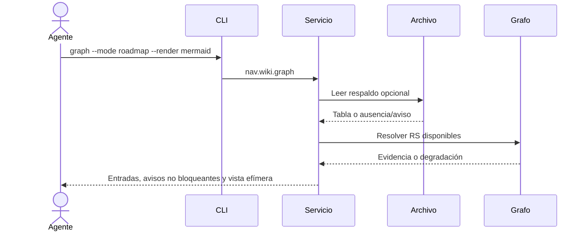

## Objetivo
Consultar prioridades locales con procedencia explícita sin mutar el canon.

## Alcance
Lectura opcional de .docs/roadmap/roadmap.md y respuesta de nav wiki graph --mode roadmap, con Mermaid solo a demanda.

## Actores
La persona o agente solicita; CLI valida modo y render; servicio lee el respaldo y consulta la generación documental disponible.

## Pre/postcondiciones
Workspace resoluble con base local accesible. La falta del archivo es válida; la respuesta conserva canonical=false y no escribe el roadmap ni Mermaid.

## Secuencia
El servicio interpreta columnas inglesas, informa avisos, resuelve RS cuando la generación lo permite y deriva nodos/dependencias. Si se solicita, proyecta los nodos por horizonte en Mermaid.



## Restricciones ADR
Se preservan el CLI local, la autoridad de la wiki y la degradación explícita descritos en ARCH-MILSP (`03_architecture.md`) y TECH-GRAPH-NATIVE. Roadmap nunca cambia readiness ni constituye un gate.

```yaml
harness_protocol: SDD-HARNESS-v1
id: FL-ROADMAP-01
kind: flow
audience: llm-first
imports:
  - .docs/wiki/00_governance.md
  - .docs/wiki/02_outcomes/RS-ROADMAP-001.md
  - .docs/wiki/03_architecture.md
exports:
  - FL-ROADMAP-01
agent_must_read:
  - .docs/wiki/04_flows/FL-ROADMAP-01.md
agent_may_edit:
  - .docs/wiki/04_flows/FL-ROADMAP-01.md
agent_must_not_edit:
  - .docs/wiki/02_outcomes/RS-ROADMAP-001.md
verify:
  - .docs/wiki/06_tests/TP-ROADMAP-001.md#casos-cada-caso-cita-el-numero-del-criterio-rf-con-disposicion-y-evidencia-esperada
stop_if:
  - harness_verdict=BLOCKED
  - roadmap_is_treated_as_canonical_readiness_or_gate
evidence:
  - .docs/wiki/04_flows/FL-ROADMAP-01.md
  - .docs/wiki/06_tests/TP-ROADMAP-001.md
  - .docs/wiki/05_requirements/RF-ROADMAP-001.md
```
