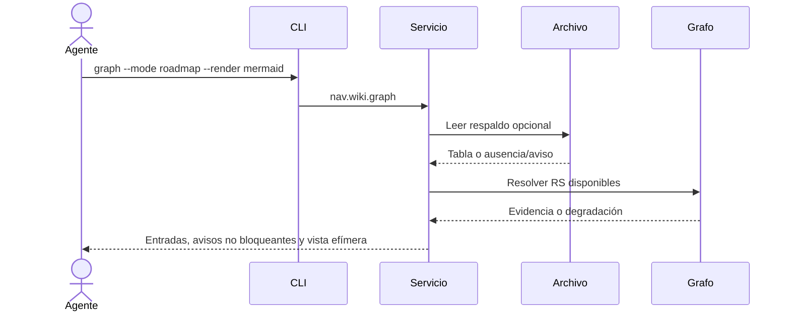

## Objetivo
Consultar prioridades locales con procedencia explícita sin mutar el canon.

## Alcance
Lectura opcional de .docs/roadmap/roadmap.md y respuesta de nav wiki graph --mode roadmap, con Mermaid solo a demanda.

## Actores
La persona o agente solicita; CLI valida modo y render; servicio lee el respaldo y consulta la generación documental disponible.

## Pre/postcondiciones
Workspace resoluble con base local accesible. La falta del archivo es válida; la respuesta conserva canonical=false y no escribe el roadmap ni Mermaid.

## Secuencia
El servicio interpreta columnas inglesas, informa avisos, resuelve RS cuando la generación lo permite y deriva nodos/dependencias. Si se solicita, proyecta los nodos por horizonte en Mermaid.

## Restricciones ADR
Se preservan el CLI local, la autoridad de la wiki y la degradación explícita descritos en ARCH-MILSP (`03_architecture.md`) y TECH-GRAPH-NATIVE. Roadmap nunca cambia readiness ni constituye un gate.
