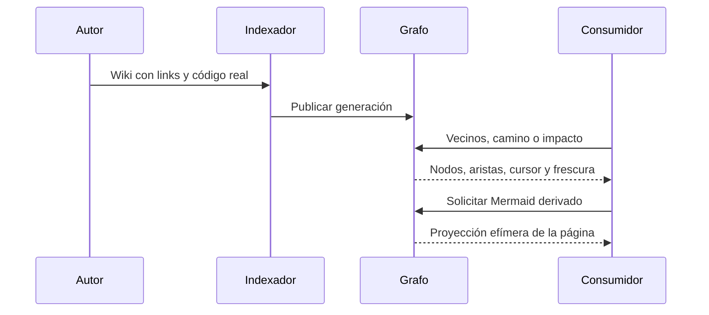

## Objetivo
Ofrecer navegación, impacto y comprobaciones de contrato sin reconstrucción manual de links.

## Alcance
Indexación nativa, consultas generacionales y proyecciones de lectura.

## Actores
Autor de la wiki, indexador, consumidor CLI/proveedor.

## Pre/postcondiciones
La wiki declara WIKI-CONTRACT-v1. La indexación nativa publica hechos documentales y observaciones de código. Las consultas conservan generación, frescura y omisiones.

## Secuencia

Las consultas no vuelven a indexar cada vez. Un cambio de fuente necesita publicación nativa nueva; no se persiste un overlay de consultas.

## Restricciones ADR
Se reutiliza el kernel de grafo existente; se mantienen los checks previos de contrato. El texto prevalece sobre los diagramas.

```yaml
harness_protocol: SDD-HARNESS-v1
id: FL-WGRAPH-001
kind: flow
audience: llm-first
imports:
  - .docs/wiki/00_governance.md
  - .docs/wiki/02_outcomes/RS-WIKI-001.md
exports:
  - FL-WGRAPH-001
agent_must_read:
  - .docs/wiki/04_flows/FL-WGRAPH-001.md
agent_may_edit:
  - .docs/wiki/04_flows/FL-WGRAPH-001.md
agent_must_not_edit:
  - .docs/wiki/05_requirements/RF-WGRAPH-001.md
  - .docs/wiki/07_technical/contracts/CT-WIKI-001.md
verify:
  - .docs/wiki/06_tests/TP-WIKI-001.md#Casos
stop_if:
  - harness_verdict=BLOCKED
  - flow_contract_or_acceptance_would_change
  - diagram_overrides_contract_text
evidence:
  - .docs/wiki/04_flows/FL-WGRAPH-001.md
  - .docs/wiki/06_tests/TP-WIKI-001.md
  - .docs/wiki/05_requirements/RF-WGRAPH-001.md
```
