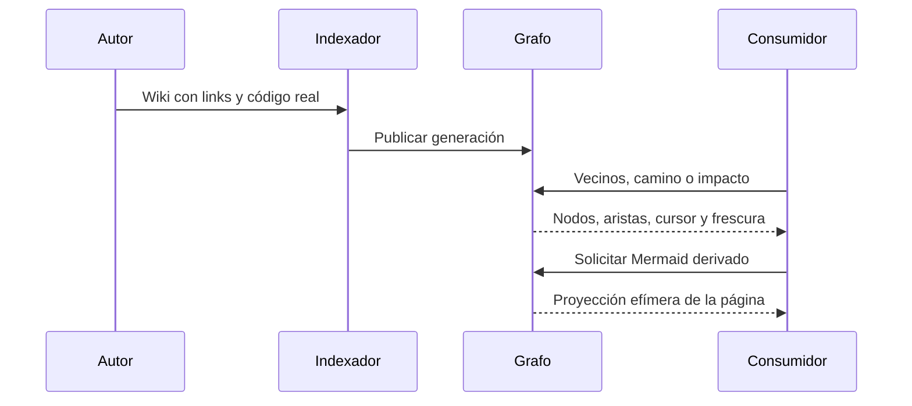

## Objetivo
Ofrecer navegación, impacto y comprobaciones de contrato sin reconstrucción manual de links.

## Alcance
Indexación nativa, consultas generacionales y proyecciones de lectura.

## Actores
Autor de la wiki, indexador, consumidor CLI/proveedor.

## Pre/postcondiciones
La wiki declara WIKI-CONTRACT-v1. La indexación nativa publica hechos documentales y observaciones de código. Las consultas conservan generación, frescura y omisiones.

## Secuencia

Las consultas no vuelven a indexar cada vez. Un cambio de fuente necesita publicación nativa nueva; no se persiste un overlay de consultas.

## Restricciones ADR
Se reutiliza el kernel de grafo existente; se mantienen los checks previos de contrato. El texto prevalece sobre los diagramas.
